<h1 align="center">Pixel P.I.</h1>

<b>Ask anything. Catch every lie.</b>

A detective game where you type your own questions to suspects, in your own words. 
In Early Access on Steam · Windows, macOS and Linux · solo-developed

<a href="https://store.steampowered.com/app/2448910/Pixel_PI/"><b>Steam</b></a> · <a href="https://store.steampowered.com/app/3758740/">Free demo</a> · <a href="https://pixelpigame.com/">Website</a> · <a href="https://crischu.itch.io/pixel-pi">itch.io</a> · <a href="https://discord.gg/RnbczNqnQ8">Discord</a>

> This repository is a showcase of the game and how it was made. The game's source code is private.

## The idea

Most detective games give you a menu of questions. You click through them, and the game does the
thinking for you.

In Pixel P.I. there's no menu. You play **Pixel**, a hacker detective who has lost two years of
memories. All she has is a list of old police case IDs, and a floating robot called **Ethan** who
says he was her partner. She hacks the police database to reopen each case. Every interview is
there, but the statements are encrypted: **each one decrypts only when you ask the question the
police asked**, phrased however you like.

So the questions are yours, and so is the "aha".

## How you play

### Ask anything

Type a question in your own words. If the police asked something like it, the statement decrypts.
If they didn't, the database tells you so, and you try another angle.

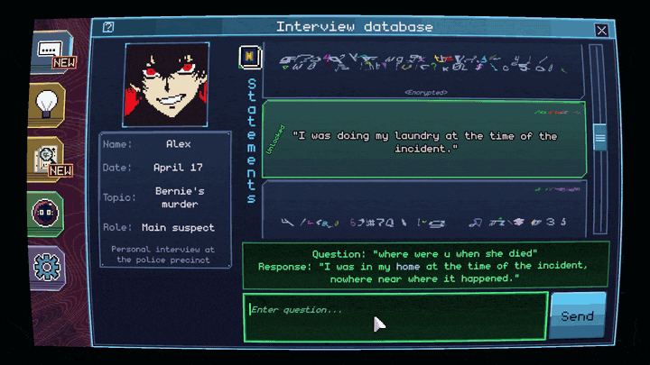

Some statements have **two layers**: the second one only opens once you know more about the case.

### Debunk

Found a clue that contradicts a statement? Pick it, then explain **in your own words** why the
statement is false. If you're right, the statement is struck through as DEBUNKED, the witness has
to correct it, and the case opens up.

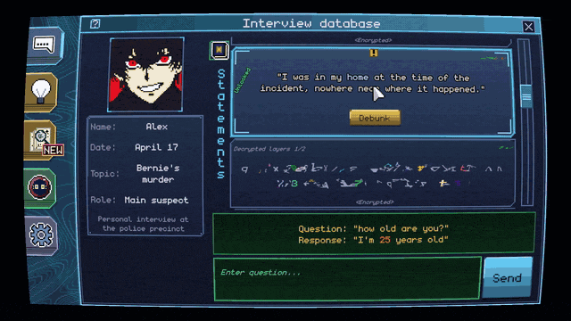

### Follow the clues

Clues and evidence cards unlock through answers, debunks and the story. A handbook (alibi, motive,
personal information, debunks…) helps you keep track, and general clue cards like Pixel's notebook
fill in her world.

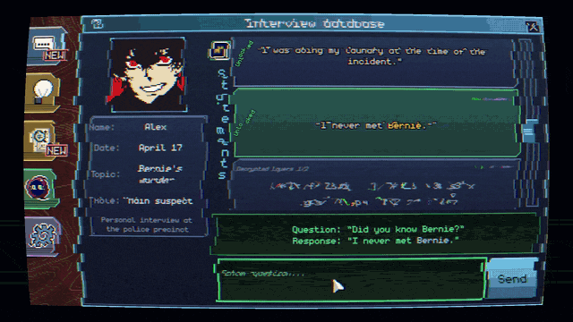

When you think you know who did it, you accuse. It can't be undone.

## The cases

Four cases are out, and two more are coming.

| | Case | The setup |
|---|---|---|
| 1 | **The Axe Murderer** (tutorial) | Bernie, a journalist investigating the city's black market, is killed with an axe on her way home from the supermarket. |
| 2 | **The Broken Case** | John, the owner of a trading card store, is killed. Days earlier his neighbour William had reported him to the police, then withdrew the report. |
| 3 | **The Remorseful Doctor** | Danton, a heart surgeon who used to work for the Zeus Health Alliance, is found dead in his bedroom with a gun in his hand. |
| 4 | **The ABCD Murder** | Barbara, a senior engineer, is found dead in the ABC Brain Components lab. Her team and the IT admin are under pressure. |
| 5 | *Melody of an Unsung Tragedy* | In development |
| 6 | *The Final Case* | Planned |

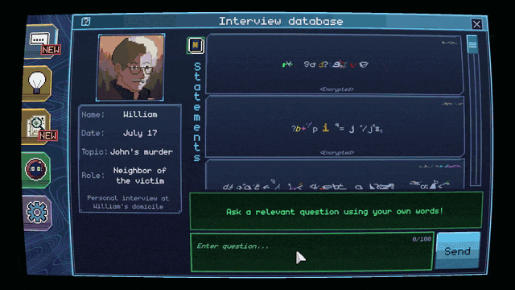

The world is near-future Saint Remy, in the Republic of Waveland, around 2089: brain implants,
holographic calls and quantum computers, all presented as a retro hacker's desktop with draggable
windows, a CRT filter and glitching encrypted text.

## Screenshots

<table>
<tr>
<td>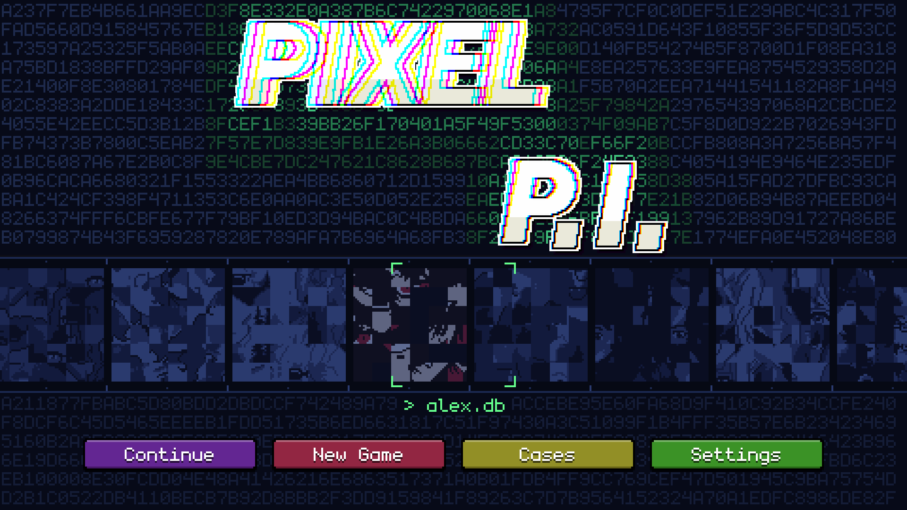</td>
<td>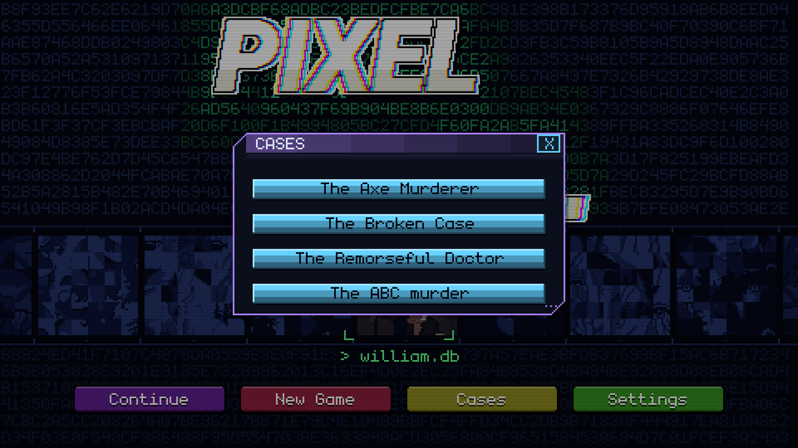</td>
</tr>
<tr>
<td>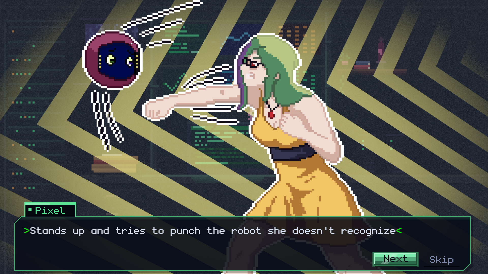</td>
<td>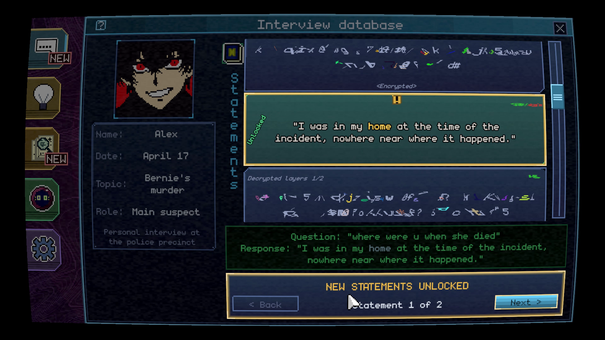</td>
</tr>
<tr>
<td>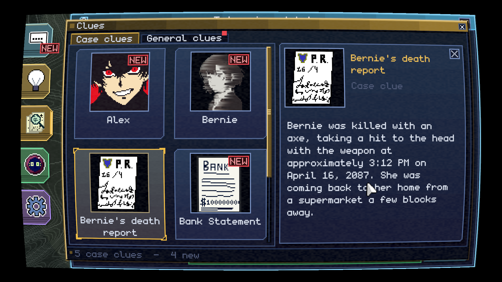</td>
<td>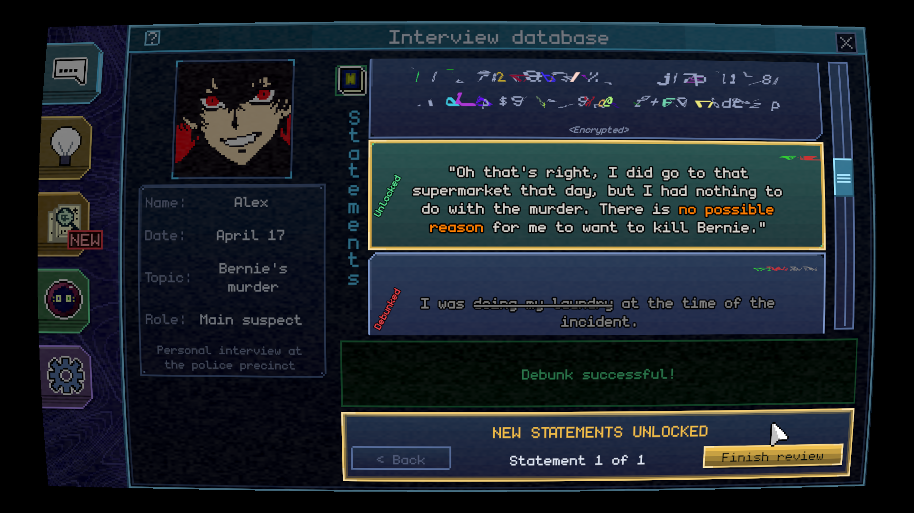</td>
</tr>
<tr>
<td>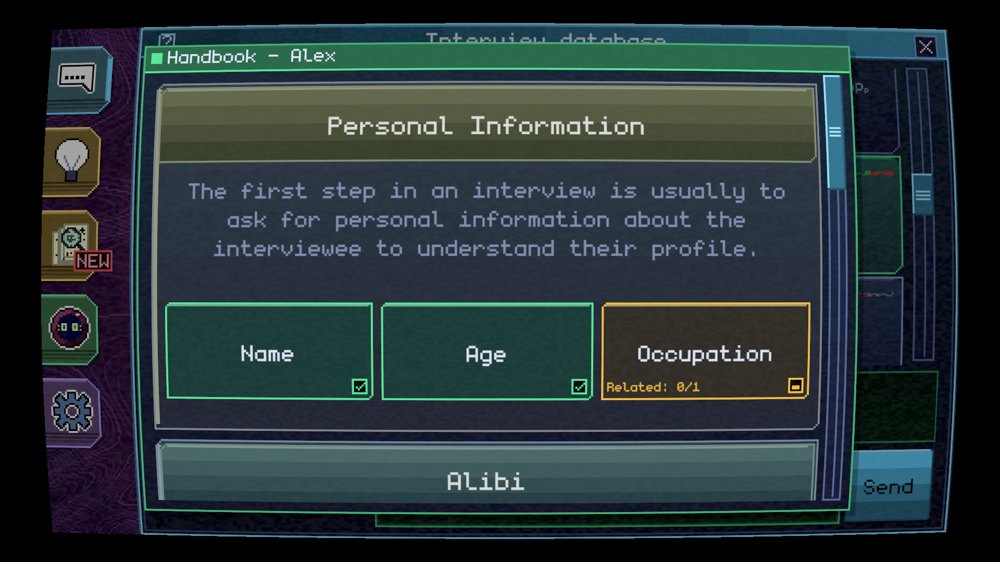</td>
<td>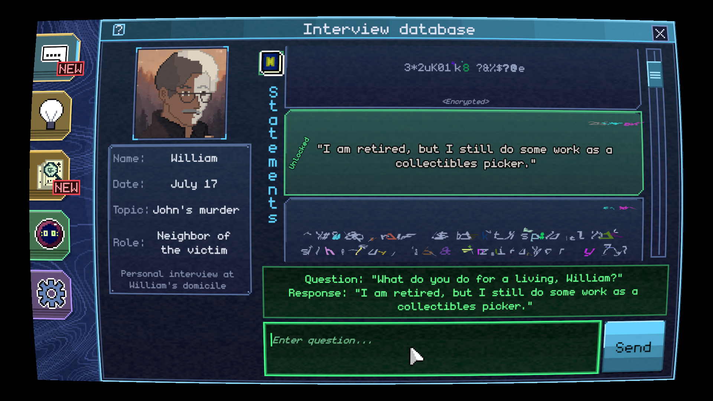</td>
</tr>
<tr>
<td>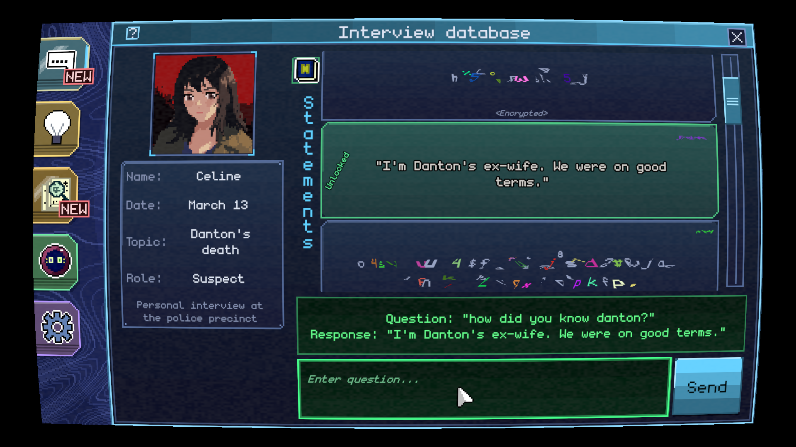</td>
<td>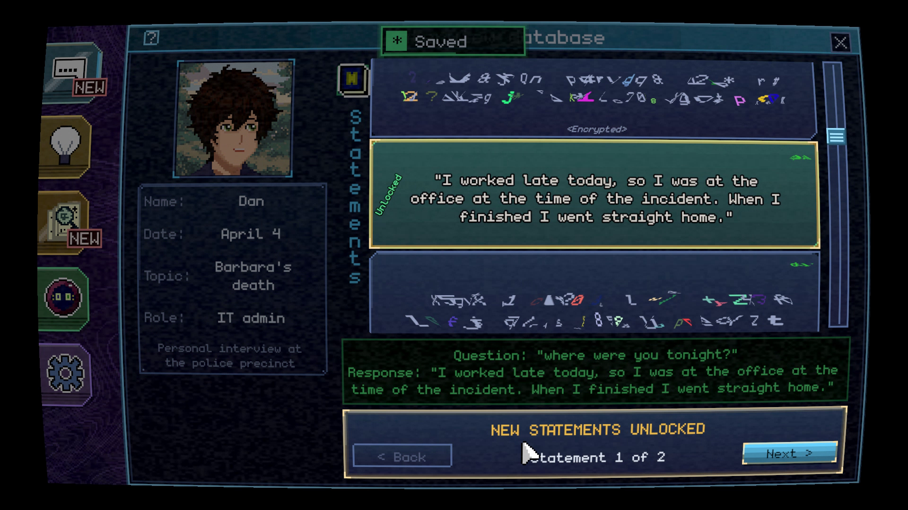</td>
</tr>
</table>

**Gameplay video** (58 s, no sound): [assets/pixel_pi_gameplay.mp4](assets/pixel_pi_gameplay.mp4)

## In numbers

## How it's built

The game is a **Unity** client (C#, URP, Steamworks) for Windows, macOS and Linux. While you play,
a small **game server** in the cloud answers your interview questions and checks your debunks, and
**Steam** takes care of the store, sign-in, achievements, stats and cloud saves.

Cases are **content, not code**. I plan the story in a wiki, write each case in my own case editor,
check every interview with a consistency script, and a one-window build pipeline ships the demo
and the full game to Steam for all three platforms.

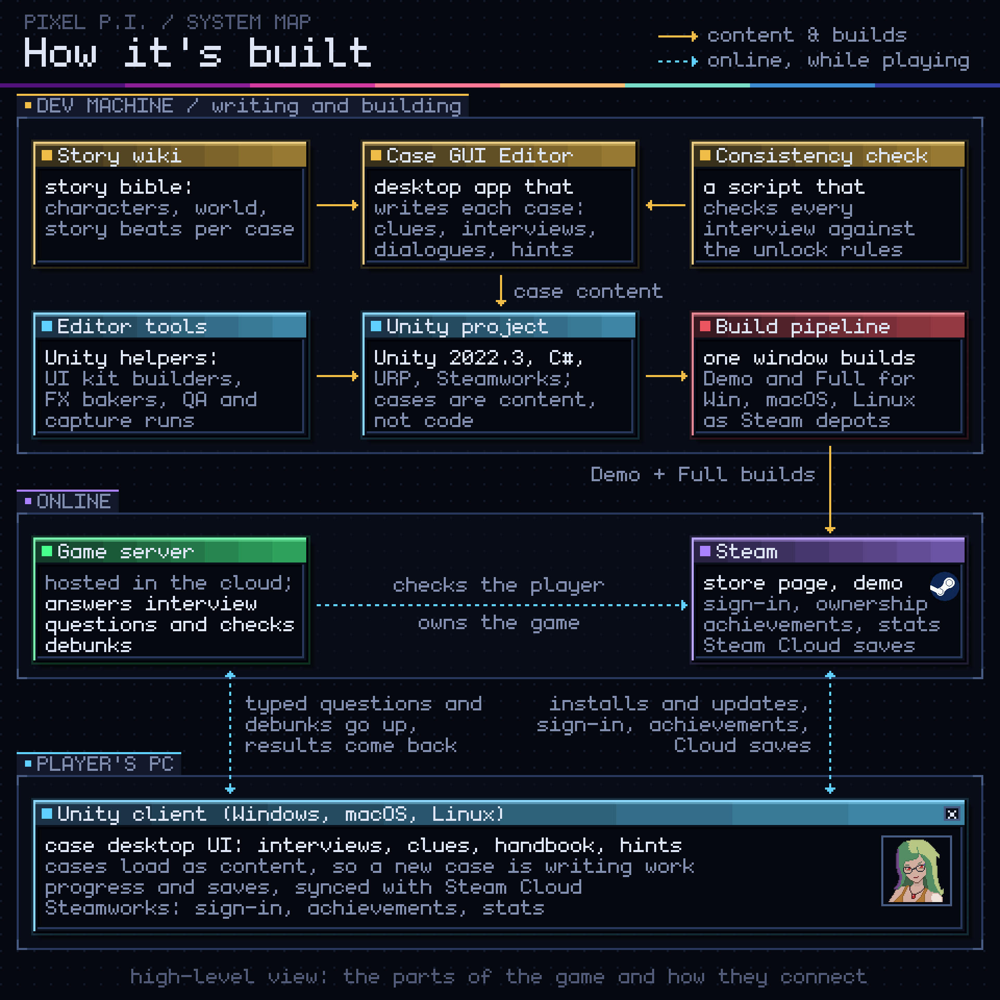

## Tools I built for it

A game like this is mostly writing, so most of the tooling is about writing cases well and
shipping them safely.

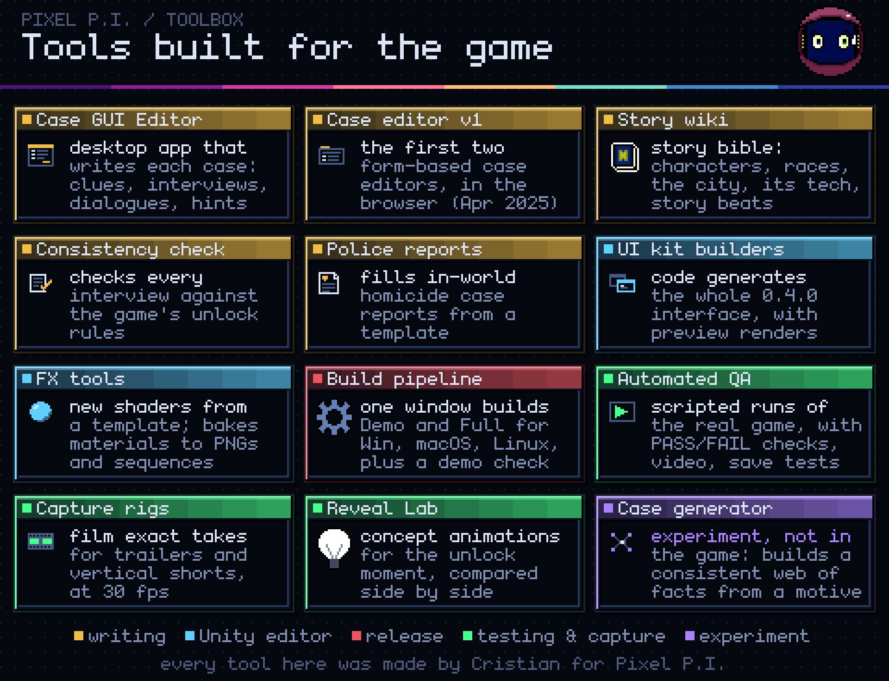

## Timeline

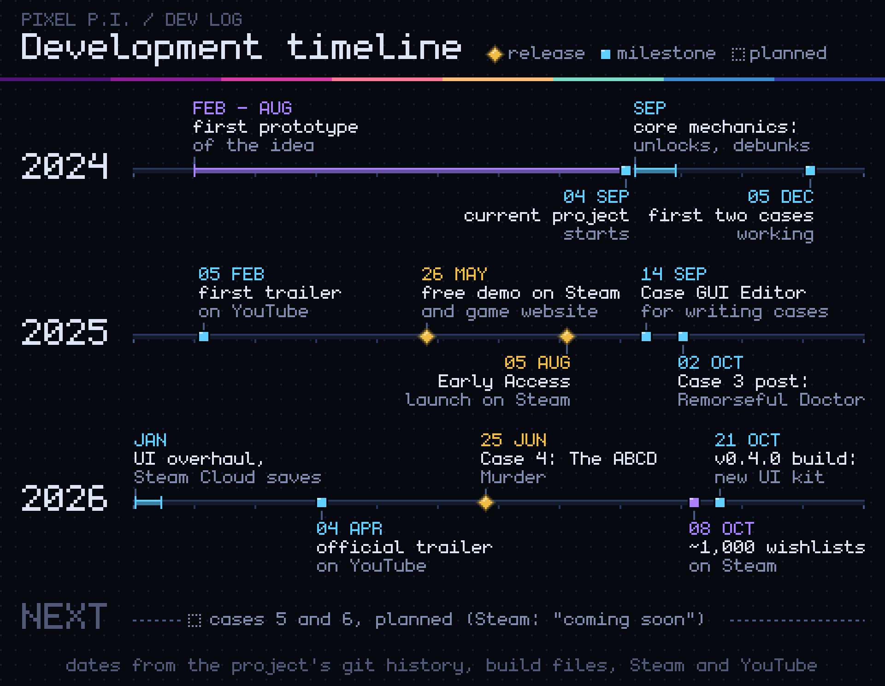

## Credits

## Play it

- **Steam:** [full game](https://store.steampowered.com/app/2448910/Pixel_PI/) · [free demo](https://store.steampowered.com/app/3758740/)
- **Website:** [pixelpigame.com](https://pixelpigame.com/) · **itch.io:** [crischu.itch.io/pixel-pi](https://crischu.itch.io/pixel-pi) · **Discord:** [discord.gg/RnbczNqnQ8](https://discord.gg/RnbczNqnQ8)

---

Made by **Cristian Desivo** (Crischu on Steam). More of my work: [case studies](https://github.com/crisdesivo/case-studies) · [cristiandesivo.com](https://cristiandesivo.com/)
